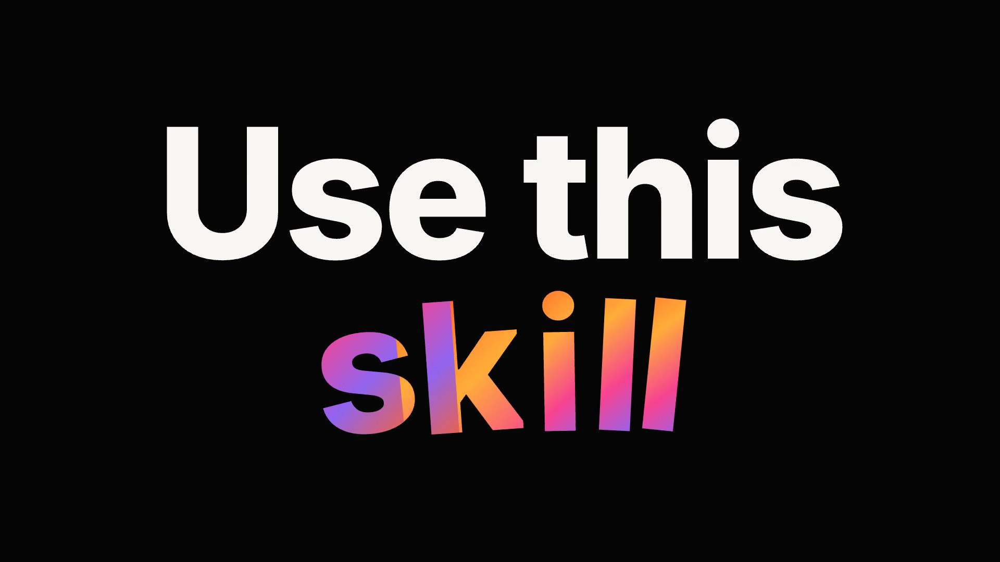

# apple-like-promo-video

[](https://agentskills.io)
[](https://developers.openai.com/codex/)
[](https://code.claude.com/docs/en/skills)
[](https://www.remotion.dev/)
[](https://www.typescriptlang.org/)
[](LICENSE)

An agent skill for directing and producing Apple-inspired promotional videos with
Remotion: bold typography, striking transitions, purposeful motion, and sound
designed together.

Built for **Claude Code and Codex**, with one shared set of instructions. The
official Remotion agent skills handle implementation knowledge; this skill adds
audiovisual direction and a workflow from brief to final export.

[](demo/skill-promo.mp4)

[Watch the 25-second promo](demo/skill-promo.mp4) ·
[Editable project and reproduction instructions](demo/README.md)

The video demonstrates a boring-to-polished transformation with large typography,
moving code, an actual 180-degree product turn, and an original score.

## Requirements

- Claude Code or Codex with access to a terminal and project files.
- Node.js and a working Remotion project/runtime.
- The [official Remotion agent skills](https://www.remotion.dev/docs/ai/skills).

The agent checks both Remotion dependencies before production and helps install
anything missing. Image and audio generation use the capabilities available in
your environment; no particular paid provider is required or bundled.

## Install

Install the creative skill for Claude Code and Codex:

```sh
npx skills add 0xlukem/apple-like-promo-video --skill apple-like-promo-video -a claude-code -a codex
```

Install the official Remotion skills as well:

```sh
npx skills add remotion-dev/skills -a claude-code -a codex
```

Choose project scope, or add `-g` for personal installation across projects.
These commands use the [Skills CLI](https://github.com/vercel-labs/skills).
Restart the agent session if the new skill is not discovered.

Remotion itself is installed separately in the video project. Installing its
skill does not install its runtime; the agent checks both before production.

For a local checkout, run this from the repository root:

```sh
npx skills add . --skill apple-like-promo-video -a claude-code -a codex
```

The installable folder is `skills/apple-like-promo-video/`. If installing by
copy or symlink, use that folder rather than the entire repository. The example
video and repository development tools are not part of the installed skill.

## Use

In Codex:

```text
$apple-like-promo-video Create a promo for my product using Remotion.
```

In Claude Code:

```text
/apple-like-promo-video Create a promo for my product using Remotion.
```

Bring your product description and any brand, visual, or audio resources you have.
The skill includes a mandatory grill-me-style creative interview in short rounds,
with recommendations and follow-up questions about unresolved choices; no separate
interview skill is required. If you have no animation ideas or references, the
agent presents two concrete directions and recommends one. With a clear supplied
concept it develops that concept; under full creative delegation it chooses and
explains one direction. Partial delegation applies only to the named decisions.
Each route includes scene examples, animation, sound, and resource needs. You can
choose, describe adjustments naturally, or set the numerical controls below.
The agent plans missing assets, presents a storyboard, and reviews hierarchy,
meaning and motion before showing a preview. Featured images receive purposeful,
impactful animation; each film gets its own treatments.
You can also request a specific stage or refine an existing promo.

The installed workflow is defined in
[SKILL.md](skills/apple-like-promo-video/SKILL.md). Source references and the
production-plan template travel with the skill; reference video projects stay
outside the installation folder.

## Workflow

1. **Brief:** a built-in creative interview with recommendations and explicit delegation.
2. **Direction:** concrete scene proposals, a dominant direction, and adjustable controls.
3. **Storyboard:** review the copy, compositions, motion, resources, and sound together.
4. **Production:** build the approved sequence in Remotion with a shared audiovisual timeline.
5. **Review:** check hierarchy, movement, readability, sound, and the rendered output.
6. **Delivery:** provide the requested export and editable project.

Existing decisions and approvals carry forward. A targeted revision reopens only
the choices it affects.

## Deliverables

For a complete video request, the workflow delivers:

- The final video in the agreed language, duration, aspect ratio, and export format.
- An editable Remotion project with preview and render instructions.
- The visual resources and their origin/usage notes.
- Separately editable music, effects, and voice tracks when used and available.
- A concise handoff describing checks performed and any remaining review limitations.

Brief-only, storyboard-only, or revision requests deliver the agreed stage.
See the [reference project](demo/README.md) for a complete example.

## Creative directions and adjustable controls

<!-- creative-guide:start -->

These controls are creative instructions on a 1–10 scale, not trained model
weights, probabilities, quality scores, or exact render settings. They guide the
agent's proposals. Start with an energetic, high-impact direction when the brief
does not specify otherwise; adapt it to the subject, audience, and available assets.

| Control | Baseline | Lower: 1–3 | Middle: 4–7 | Higher: 8–10 |
| --- | --- | --- | --- | --- |
| **Motion impact** (`motion_impact`) | **8** | Restrained travel; one deliberate reveal and a clear hold | Noticeable scale/depth changes and controlled settling | Bold scale contrast, decisive reveals, and memorable transformations with readable arrivals |
| **Typography prominence** (`typography_prominence`) | **8** | Supporting labels; product or visual evidence leads | Headlines share attention with the subject | Giant hero words and letter choreography own selected beats |
| **Editing pace** (`editing_pace`) | **7** | Longer shots and pauses for discovery | Alternating active passages and reading holds | Shorter shots and rapid sequences, with essential reading time preserved |
| **Visual density** (`visual_density`) | **3** | One dominant element with generous negative space | A hero plus a few supporting elements | Layered evidence or detail, introduced in a clear order around one focal point |
| **Color expressiveness** (`color_expressiveness`) | **6** | Neutrals or restrained brand color | Selective accents and controlled color changes | Vivid contrast, animated gradients, or bold color transitions within the chosen identity |
| **Sound energy** (`sound_energy`) | **8** | Sparse cues, space, and a restrained arrangement | Rhythmic support with selected accents | Driving rhythm, stronger arrangement contrast, and emphatic synchronized events |

Impact is independent of speed: a slow reveal can have high impact. Sound energy
is independent of loudness and does not prescribe BPM. Typography prominence
changes attention, not word count. Every featured image still needs authored
motion; lower settings allow restraint, not generic static slides. Intentional
holds give the active moments contrast. Brand constraints and explicit requests
take precedence over these starting values.

### Direction recipes

Choose one dominant direction and borrow compatible gestures from another. These
recipes describe an emphasis, not mutually exclusive categories or fixed shot lists.

| Direction | Best suited to | Typical proposal | Starting changes to the baseline |
| --- | --- | --- | --- |
| **Cinematic product** | A product whose form, material, interface, or detail sells the benefit | Detail-to-object reveal, controlled light/depth, product-led framing, tactile sound | Typography **5**, editing pace **5**, sound energy **7** |
| **Kinetic typography** | A short, strong message that benefits from words performing | Hero-word takeovers, masked transitions, letter choreography, rhythmic accents | Motion impact **9**, typography **9**, editing pace **8**, color **7** |
| **Visible transformation** | A benefit that can be demonstrated through a change or comparison | Preserve the subject through a before/after, reveal the improvement, then land the claim | Typography **6**, visual density **4** |

The unchanged controls retain their baseline values. Recipe settings are initial
proposals; explicit user settings win. Borrowing a secondary gesture does not
average the recipes or reset the chosen controls. A transformation can, for
example, be presented with cinematic product shots and one kinetic headline.

### Natural language or direct adjustment

You can describe the feeling, set individual values, or combine both:

- “Make it more elegant and paused, but keep the product reveal powerful.”
- “Use motion impact 8 and editing pace 4; keep the other agreed settings.”
- “Let the product lead. Use giant type only for the main benefit.”
- “Give the music more drive without increasing the playback volume.”

The agent translates the request into a proposed direction and records the
settings and their visible/audible consequences in the production plan. You can
adjust them in conversation without editing a skill file. Numerical adjustments
remain available alongside natural-language questions; neither is required to use
the other. Settings guide the film as a whole, with documented exceptions for
specific beats such as a deliberately flat before-state or a quiet ending.

<!-- creative-guide:end -->

## Repository layout

| Path | Purpose |
| --- | --- |
| `skills/apple-like-promo-video/SKILL.md` | Installable workflow, embedded creative interview, and production steps |
| `skills/apple-like-promo-video/references/` | Creative controls, direction, dependencies, and source references |
| `skills/apple-like-promo-video/templates/` | Reusable brief and production-plan template |
| `demo/` | Complete reference video, editable Remotion source, and original audio |
| `scripts/sync-direction-guide.py` | Keeps the README tables synchronized with the skill reference |
| `LICENSE` | MIT license |

## Development

The [creative controls reference](skills/apple-like-promo-video/references/creative-controls.md)
is the source of truth for the tables above. After editing it, regenerate the
README and check for drift:

```sh
python3 scripts/sync-direction-guide.py
python3 scripts/sync-direction-guide.py --check
```

If the official skill-creator validator is installed, validate the skill folder:

```sh
python3 /path/to/skill-creator/scripts/quick_validate.py skills/apple-like-promo-video
```

To inspect, check, and render the reference project:

```sh
cd demo
npm ci
npm run lint
npm run dev
```

Run `npm run render` from that project directory to export the video. Included
audio is ready to use; regeneration instructions are in the
[example README](demo/README.md).

## Compatibility

The skill uses standard `SKILL.md` instructions and relative references for Claude
Code and Codex. Installation was checked for both agents; the reference video was
produced in Codex. Full production through native Claude Code and Cowork has not
been verified. The Remotion and TypeScript badges describe the included reference
project's versions, not required versions for every project.

## License

[MIT](LICENSE). Third-party dependencies retain their respective licenses.

This is an independent project, not affiliated with or endorsed by Apple. It
teaches audiovisual techniques using source attribution; Apple media, fonts,
logos, and campaign audio are not distributed with the skill.
